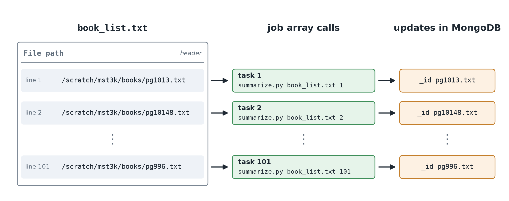
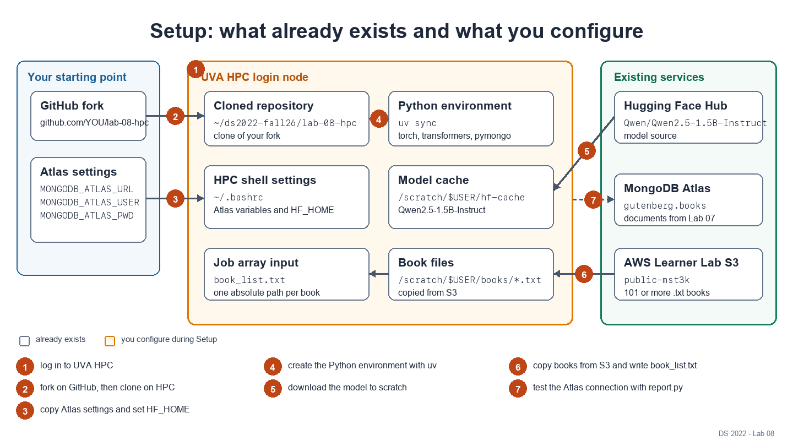
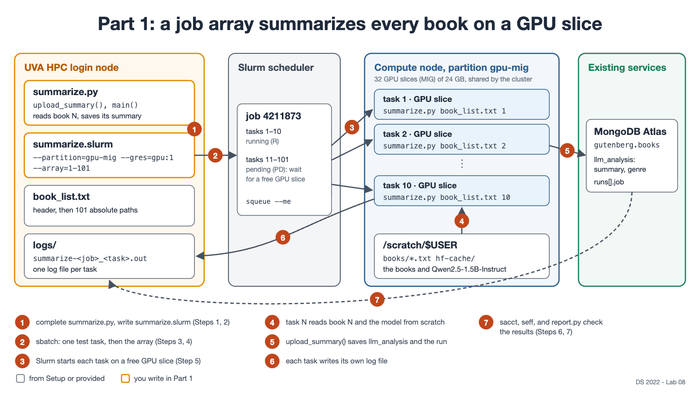

# Lab 08: Summarize Books with Transformer Models on UVA HPC

> [!CAUTION]
> **Do NOT click Reset in the AWS Academy Learner Lab unless your instructor tells you to.**
> Reset permanently deletes everything in your lab account (S3 buckets, EC2 instances, Lambda functions, ...) and cannot be undone. To pause, click **End Lab** instead. Your resources will remain available the next time you click **Start Lab**.

In [Lab 07](https://github.com/ksiller/lab-07-ec2-lambda), every book in your `public-mst3k` bucket received a MongoDB document containing its title, author, and word counts. Your Lambda function also creates a document for each new upload. In this lab, you add what word counts cannot reveal: **a language-model summary and genre for each book.** You use a Slurm job array on the UVA HPC cluster to process many books in parallel, while GPUs (if available) accelerate the language-model analysis within each task:

1. **Part 1: Process all books in parallel with a Slurm job array.** During Setup, you write a script that copies the books to the cluster. You then write a job script that runs one task per book, many at the same time, each on its own GPU slice. You test one task, submit the full array, monitor it, and inspect its resource usage.
2. **Part 2 (optional): Process only books that are still missing summaries.** You write a short query that finds books without a summary, then run the job array only for those books.

Lambda and HPC now work side by side: the Lambda function performs event-driven analysis after each upload, while the HPC job handles more compute-intensive analysis in batches.

`src/book_analysis/summarize.py` runs the language model on one book. You complete the code that reads its arguments and saves the result to MongoDB. You also write a script that retrieves the books and a Slurm job script that runs `summarize.py` for all book texts.

> [!IMPORTANT]
> `mst3k` is a placeholder. Replace it everywhere with your UVA computing ID, for example `public-mst3k` → `public-abc2de`. If your Lab 06 bucket has a different name, use that name.

> [!TIP]
> **Plan your time.** Much of this lab involves waiting rather than typing. `uv sync` and the model download each take a few minutes, and jobs remain in the Slurm queue until GPUs are available. Wait times are often longer when many students submit near the deadline. Complete the Setup and the test in Part 1, Step 3 early so that you have time to diagnose problems and submit again. You do not need to stay logged in while your jobs run.

## Learning goals

**Part 1: Batch jobs with Slurm**

- Understand what an HPC cluster is: login nodes, compute nodes, and the scheduler
- Know what operations to do on a login node and what should be done on compute nodes
- Complete a Python script that runs on a compute node, reads its arguments, saves its results in MongoDB, and handles errors with `try`/`except` and logging
- Write a Slurm job script to request compute resources: CPU cores, GPUs (if needed), memory, time limit, and log files
- Split one large job into the tasks of a job array (`--array`, `$SLURM_ARRAY_TASK_ID`)
- Submit, watch, and cancel jobs (`sbatch`, `squeue`, `scancel`)
- Inspect the resources used by a finished job (`sacct`, `seff`) and use that information to size the next job

**Part 2 (optional): Incremental processing**

- Query MongoDB for the documents that are still missing a field (`$exists`), and use the result to restrict the jobs to books that have not been processed yet

The lab builds on:

- [Lab 01: The command line](https://github.com/ksiller/lab-01-cli): `ssh` to the HPC cluster
- [Lab 05: NoSQL with MongoDB](https://github.com/ksiller/lab-05-nosql): your Atlas cluster
- [Lab 06: Working with S3](https://github.com/ksiller/lab-06-s3): your bucket holds the books
- [Lab 07: EC2 and Lambda](https://github.com/ksiller/lab-07-ec2-lambda): the documents this lab adds to
- [HPC Access](https://github.com/ksiller/DS2022/blob/main/setup/hpc.md) and [Class 08: HPC](https://github.com/ksiller/DS2022/blob/main/class/08-hpc/README.md): submitting jobs and job arrays

## What is in this repository

```text
lab-08-hpc/
├── README.md
├── pyproject.toml              # uv project: pymongo, torch, transformers
├── uv.lock
├── src/book_analysis/
│   ├── summarize.py            # summarizes one book; saves result in MongoDB (you complete it)
│   └── report.py               # proof of completion
├── summarize.slurm             # job script template (you complete it)
├── KNOWLEDGE_CHECK.md          # questions you answer for your submission
├── docs/                       # diagrams for this README
└── CLAUDE.md                   # instructions for Claude Code, if you use it
```

You create the following:

- `get_books.sh` and the `book_list.txt` file it writes (Setup)
- `upload_summary()` and `main()` in `summarize.py`, and the job script `summarize.slurm`, which you complete from its template (Part 1)
- `results/`, containing the report and outputs for your submission
- `src/book_analysis/pending.py`, if you complete the optional Part 2

Write your answers in `KNOWLEDGE_CHECK.md`. Do not modify `README.md`.

## What is computed

`summarize.py` summarizes **one** book file and adds an `llm_analysis` subdocument to the book's existing document in `gutenberg.books`. The file name, for example `pg11.txt`, is the document's `_id` and was the book's key in your bucket in Labs 06 and 07. The fields from Lab 07 remain unchanged:

```json
{
  "_id": "pg11.txt",
  "title": "Alice's Adventures in Wonderland",
  "author": "Lewis Carroll",
  "word_count": 27427,
  "...": "the other fields from Lab 07",
  "llm_analysis": {
    "summary": "Alice falls down a rabbit hole, enters a fantastical world, meets characters like the Duchess and the Mock Turtle, and embarks on adventures including a mock turtle's story and a croquet game with the Queen.",
    "genre": "adventure",
    "model": "Qwen/Qwen2.5-1.5B-Instruct",
    "at": "2026-11-12T15:20:41Z"
  },
  "runs": [
    {"host": "my-laptop",      "at": "2026-10-27T14:41:05Z"},
    {"host": "ip-172-31-5-20", "at": "2026-10-27T15:02:11Z"},
    {"host": "udc-an36-1",     "at": "2026-11-12T15:20:41Z", "job": "4211873_1"}
  ]
}
```

| Field                 | Meaning                                                                                                  |
| --------------------- | -------------------------------------------------------------------------------------------------------- |
| `llm_analysis.summary` | a summary of the book, three sentences long, written by the model                                       |
| `llm_analysis.genre`   | one of ten genres selected by the model, such as `adventure`, `romance`, or `horror`, or `unknown`      |
| `llm_analysis.model`   | the language model: when a better model comes along, it tells which documents to redo                   |
| `llm_analysis.at`      | when the summary was written                                                                             |
| `runs[].job`          | **new in this lab:** the Slurm job array and the task that processed the book, for example `4211873_1`   |

A book without `llm_analysis` has not been summarized yet; that is what the optional Part 2 looks for.

**How the summary and genre are generated.** [Qwen2.5-1.5B-Instruct](https://huggingface.co/Qwen/Qwen2.5-1.5B-Instruct) is a small, 1.5-billion-parameter transformer model trained to follow instructions. `summarize_book()` provides the beginning of the book and asks the model to summarize the story in three sentences, then select one of the ten genres in `GENRES`. The model can read at most 32,768 tokens at once, or about 24,000 words, so it receives the first 20,000 words (`MAX_WORDS`). This includes all of a short book such as *Alice's Adventures in Wonderland*, but only the opening chapters of a long book.

You download the model once from the [Hugging Face Hub](https://huggingface.co/) into your scratch directory (Setup step 5). Processing thousands of tokens is computationally intensive: a GPU can summarize a book in seconds, while a CPU may take many minutes.

**How the work is divided.** `book_list.txt` begins with the header `File path`, followed by one book file per line. Part 1 runs one job array with one task per book. Slurm assigns each task a number in `$SLURM_ARRAY_TASK_ID`, starting at 1. Your job script passes that number to `summarize.py`, which summarizes the corresponding book (counting from 1 after the header):



## Setup



Run every step in this Setup section from a shell on an HPC login node.

### 1. Log in to UVA HPC

Follow [HPC Access](https://github.com/ksiller/DS2022/blob/main/setup/hpc.md) and log in to a login node with `ssh`, as in [Lab 01](https://github.com/ksiller/lab-01-cli), Part 2. If you are **off Grounds**, connect to the UVA VPN first.

```bash
ssh mst3k@login.hpc.virginia.edu
```

You can also use the shell or a Code Server (VSCode) session in [Open OnDemand](https://ood.hpc.virginia.edu).

You are now on a **login node**, which is shared with hundreds of other users. Use it to edit files, run `git` and `uv sync`, download the model and books, and submit jobs. The summaries themselves must run on compute nodes as Slurm jobs (Part 1).

### 2. Fork and clone this repository

Fork this repository on GitHub (keep the default name): [https://github.com/ksiller/lab-08-hpc](https://github.com/ksiller/lab-08-hpc). Clone **your fork** on HPC:

```bash
mkdir -p ~/ds2022-fall26/
cd ~/ds2022-fall26/
git clone https://github.com/YOUR_USERNAME/lab-08-hpc.git
cd lab-08-hpc
pwd
```

`pwd` should print a path ending in `ds2022-fall26/lab-08-hpc`. This README refers to that location as the *top directory* of your cloned repository, i.e. the directory containing `README.md`. Submit every job from this directory; for example, run `sbatch summarize.slurm ...` here.

### 3. Environment variables

Your jobs need your MongoDB Atlas settings and a location for the transformer model. On HPC, open `~/.bashrc` in an editor, for example with `nano ~/.bashrc`, and add the following lines. Copy the three Atlas values from `~/.zshrc` or `~/.bashrc` on your computer (Lab 05):

```bash
export MONGODB_ATLAS_URL="mongodb+srv://..."
export MONGODB_ATLAS_USER="..."
export MONGODB_ATLAS_PWD="..."
export HF_HOME=/scratch/$USER/hf-cache
```

Replace each `"..."` with your Atlas value. `HF_HOME` tells Hugging Face to save the model in your **scratch** directory, which is larger and faster than your home directory. Files in scratch that have not been used for 90 days are deleted; that is long enough for this course.

Reload `~/.bashrc`, then verify that all four variables are set without displaying their values:

```bash
source ~/.bashrc
printenv MONGODB_ATLAS_URL MONGODB_ATLAS_USER MONGODB_ATLAS_PWD HF_HOME >/dev/null \
    && echo "All variables are set"
```

**Your Atlas IP Access List** should already allow HPC through the UVA entries from Lab 05 and `0.0.0.0/0` from Lab 07. Confirm that your cluster is not paused (Lab 07, Setup, Step 1).

**Test the Atlas variables with `mongosh`.** The cluster provides `mongosh` as a module. Load it, then count the documents in `gutenberg.books`, as in Lab 07, Setup, Step 1.

```bash
module load mongosh
mongosh "$MONGODB_ATLAS_URL" --apiVersion 1 --username "$MONGODB_ATLAS_USER" --quiet --eval 'db.getSiblingDB("gutenberg").books.countDocuments()'
```
When prompted for your password, paste the value of `MONGODB_ATLAS_PWD`. Do not add `--password "$MONGODB_ATLAS_PWD"` to the command: on a shared login node, other users can see command arguments with tools such as `ps`.

The command should print `101`, the number of documents created in Lab 07. This confirms that your credentials work and that you can connect to your MongoDB Atlas cluster. If you uploaded additional books and get a higher number, that's OK.

### 4. Python environment

Review the `dependencies` section of `pyproject.toml`. It defines the packages used by this lab:

- `transformers`: loads and runs the Hugging Face model
- `torch`: provides the PyTorch framework used by the model
- `pymongo`: connects Python to MongoDB

Set up the environment:
```bash
module load uv
uv sync
```

`module load` makes cluster-provided software available in your shell. In this case, it loads `uv`. When run from the top directory of the repository, `uv sync` creates the environment defined by `pyproject.toml`, including PyTorch and Hugging Face Transformers.

### 5. Download the model

Download the language model into `$HF_HOME`, once, on the login node:

```bash
uv run hf download Qwen/Qwen2.5-1.5B-Instruct
du -sh $HF_HOME
```

`hf` is the [Hugging Face Hub command-line tool](https://huggingface.co/docs/huggingface_hub/guides/cli), installed with `transformers` by `uv sync`. `du` should report about 3 GB. You need to download the model only once. Because `HF_HOME` points to this shared local copy, each job can use the model without downloading the same 3 GB again.

### 6. Get the books: write `get_books.sh`

Your compute jobs should read the book files from the cluster's file system rather than directly from S3. Learner Lab credentials expire after a few hours, and a job may remain queued longer than that. Copy the books while your credentials are valid so that the jobs require no AWS access. You will write a short Bash script that copies the books and creates the input list for the job array.

Load the AWS CLI module and confirm that it is available:
```bash
module load awscli
aws --version
```

**Get your AWS credentials.** On the AWS Academy **Learner Lab** page, click **Start Lab**, then **AWS Details** → **AWS CLI** → **Show**. On HPC, create the two AWS CLI files as you did on your computer (Lab 07, Setup, Step 4). Paste the credentials block into `~/.aws/credentials`; for example, use `mkdir -p ~/.aws` and `nano ~/.aws/credentials`.

Configure the default AWS region and output format:

```bash
aws configure
```
For `region`, enter `us-east-1`. For `output`, enter `json`. Accept the defaults for the other prompts.

Confirm your configuration:
```bash
cat ~/.aws/config
```

You should see:
```text
[default]
region = us-east-1
output = json
```

Check that the CLI works:

```bash
aws sts get-caller-identity
```

**Write a Bash script `get_books.sh`** in the top directory of your cloned repository. It must:

| Requirement | Hint |
| --- | --- |
| take two arguments: the name of your bucket and the directory for the books | `$1`, `$2`; `bash get_books.sh public-mst3k /scratch/$USER/books` |
| start with the appropriate Bash shebang | |
| create the book directory if it does not exist yet | `mkdir -p` |
| copy every `.txt` file of the bucket into the book directory, and nothing else (not `index.html`) | [`aws s3 cp`](https://docs.aws.amazon.com/cli/latest/reference/s3/cp.html) with `--recursive`, `--exclude "*"`, and `--include "*.txt"` |
| write a new file `book_list.txt` in the current directory: first the header line `File path`, then one book file per line | `echo` with `>` for the first line, `>>` to append the others |
| list the **absolute path** of each book file, such as `/scratch/mst3k/books/pg1013.txt`, not `pg1013.txt` or `books/pg1013.txt` | [`find`](https://www.gnu.org/software/findutils/manual/find.html) with `-name "*.txt"` prints each path starting with the directory you give it, so give it an absolute directory; [`realpath`](https://www.gnu.org/software/coreutils/manual/html_node/realpath-invocation.html) turns a relative directory into an absolute one |
| list the books in sorted order, so that a task number always means the same book | `sort` |
| print how many books it listed | `wc -l`, without the header |
| stop at the first error, for example when your credentials expired | `set -euo pipefail` below the line `#!/bin/bash` |

**Why absolute paths?** Job tasks run on compute nodes, and Slurm may start them in a different directory. An absolute path such as `/scratch/mst3k/books/pg1013.txt` works from any location because every node sees the same `/scratch` directory tree.

Run your `get_books.sh` script. **Replace `public-mst3k`** with the name of your bucket:

```bash
bash get_books.sh public-mst3k /scratch/$USER/books
head -n 3 book_list.txt
```

The commands should produce output like this:
```text
Wrote 101 book files to book_list.txt
File path
/scratch/mst3k/books/pg1013.txt
/scratch/mst3k/books/pg10148.txt
```

The 101 books consist of the 100 books from Lab 06 plus `pg74.txt` from Lab 07. If you uploaded additional books in Lab 07, your count will differ; use your count wherever this README uses 101.

You now have local copies of all your books and a corresponding list of paths in `book_list.txt`. It is fine if your Learner Lab credentials expire after this point; you do not need them to submit or run the analysis jobs.

### 7. Test on the login node

Check that you can reach your database:

```bash
uv run python src/book_analysis/report.py
```

The command prints one JSON document. `documents` should be `101`, from Lab 07, and `summarized` should be `0`. If so, Atlas and your environment are configured correctly.

## Part 1: Summarize all books with a Slurm job array

**The Case:** On a CPU, one book takes ten minutes or more, and 101 books, one after another, take most of a day. A job array runs one task per book, many at the same time, each on its own GPU slice, and you do not even have to stay logged in while they run.



### Step 1: Complete `summarize.py`

Open [src/book_analysis/summarize.py](src/book_analysis/summarize.py). Each task in the job array will run this script to summarize one book. You will modify it to accept two command-line arguments: the book list you created in Setup step 6, and a task number. The template already defines the model settings as variables (`MODEL`, `GENRES`, `MAX_WORDS`, and `PROMPT`) and provides the `read_book()` and `summarize_book()` functions. Complete the `upload_summary()` and `main()` functions where the file says `TODO`. Your `main()` function must include the command-line argument parsing.

| Function           | What it does                                                                                            | Who writes it |
| ------------------ | ------------------------------------------------------------------------------------------------------- | ------------- |
| `read_book()`      | returns the text of a book file, without Project Gutenberg's header and license                         | provided      |
| `summarize_book()` | runs the language model on the book, and returns a summary and a genre                                  | provided      |
| `upload_summary()` | saves the summary and the genre in the book's document in MongoDB                                       | you           |
| `main()`           | **entry point:** reads the command-line arguments, picks book number `TASK_ID` of the list, and calls the other functions | you           |

Read `summarize_book()` first. Then write `upload_summary()`, and last `main()`, which calls the others. Follow the [best practices](https://github.com/ksiller/DS2022/blob/main/best-practices.md): a docstring for each function (the stubs have them), `logging` instead of `print` for status and errors, and `try`/`except` around calls to external services, here MongoDB.

**How `summarize_book(text)` works.** It takes the text of a book, from `read_book()`, and returns a tuple `(summary, genre)`: a summary, three sentences long, and a genre, one of `GENRES`, or `"unknown"`.

1. It picks the device the model runs on, `"cuda"` or `"cpu"`, and logs it (see *Why the device is picked inside* below). CUDA is NVIDIA's platform for running computations on its GPUs. On a node without a GPU, the model runs on the slower CPU.
2. It loads the model: `pipeline("text-generation", ...)` returns a function that it calls with the prompt. `dtype=torch.bfloat16` stores each of the 1.5 billion numbers of the model in 2 bytes instead of 4, so the model needs about 3 GB of GPU memory.
3. It keeps the first `MAX_WORDS` words of the book and fills them into `PROMPT`, which asks for three sentences and a last line `Genre: ...`.
4. It calls the model with a chat message, a list of dictionaries with a `role` and a `content`. `do_sample=False` makes the answer the same on every run. The pipeline returns the whole conversation; the last message, `[-1]["content"]`, is the model's answer.
5. It splits the answer at `"Genre:"` with `rpartition()`: the part before it is the summary, the part after it the genre. An answer without `Genre:`, or with a genre that is not in `GENRES`, gets `"unknown"`.

**Why the device is picked inside `summarize_book()`.** A GPU is fast only for the code that runs on it. PyTorch, the library under `transformers`, runs the model on the CPU unless you put it on the GPU, and `device="cuda"` does that. `torch.cuda.is_available()` is `True` only if the task has access to a GPU. With `"cpu"` as the fallback, the same code still works there, only much slower. The model is the only part of `summarize.py` that uses the GPU, so the device is picked where the model is loaded, and `main()` and `upload_summary()` do not need to know about it. The `INFO` line that logs the device tells you afterwards whether your task got a GPU.

Now write the two functions:

- `upload_summary(key, summary, genre, job)`
  - **Arguments:** `key`, the `_id` of the book's document, such as `"pg11.txt"`; `summary` and `genre`, from `summarize_book()`; `job`, the job and task ID, such as `"4211873_5"`, or `None` outside of Slurm (see `main()`).
  - **Returns:** nothing.
  - **Inside:**
    1. Connect to your Atlas cluster with your environment variables, as in [Lab 05](https://github.com/ksiller/lab-05-nosql): `MongoClient(os.environ["MONGODB_ATLAS_URL"], username=..., password=...)`.
    2. In a `try` block, call `update_one()` on the collection `gutenberg.books`, with the filter `{"_id": key}` and an update with two operators:
       - `$set` the subdocument `llm_analysis`, with the fields `summary`, `genre`, `model` (the constant `MODEL`), and `at`, the time now: `datetime.now(timezone.utc)`.
       - `$push` one run to the list `runs`: `{"host": socket.gethostname(), "at": ..., "job": job}`, the same format as the runs from Lab 07.
    3. `except PyMongoError as e`: log the error with `logger.error`, including the key, then `raise` it again. The task then ends with an error, and `sacct` shows it as `FAILED`. If you only logged it, the task would end as `COMPLETED` without a summary in the database, and you would not notice.
    4. `finally`: close the client with `client.close()`.
    5. `update_one()` returns a result. If `result.matched_count` is `0`, there is no document with this `_id`: log a warning.

  [What is computed](#what-is-computed) shows the document after the update.
- `main()`
  - **Arguments:** none; it reads the command line: `summarize.py BOOK_LIST TASK_ID`.
  - **Returns:** nothing.
  - **Inside:**
    1. Set up logging: `logging.basicConfig(level=logging.INFO, format="%(levelname)s %(message)s")`, so the `INFO` lines reach the task's log file.
    2. Read the two arguments from `sys.argv`, as in Lab 06 and in `my_array.py` from Class 08. `sys.argv[2]` is a string, such as `"5"`; convert it with `int()`. If there are not exactly two arguments, log a usage message such as `Usage: summarize.py BOOK_LIST TASK_ID` and `sys.exit(1)`. *Optional:* use [`argparse`](https://docs.python.org/3/library/argparse.html) instead, with `type=int` for the task number: it writes the usage message and the `--help` text for you.
    3. Read the lines of the book list, without empty lines and without the header `File path`.
    4. If the task number is not from `1` to the number of books, log an error that says the valid range, and `sys.exit(1)`.
    5. Pick the book: task `1` is the first book, so it is at index `task_id - 1` of your list. Its `_id` in MongoDB is the file name without the directory. *Hint:* split the absolute path at each `/` and take the last element: `"/scratch/mst3k/books/pg11.txt".split("/")[-1]` is `"pg11.txt"`. Log the task number and the path.
    6. Call `read_book()` and `summarize_book()`, and log the key, the genre, and how long it took: `time.time()` before and after.
    7. Build `job`: Slurm sets the variables `SLURM_ARRAY_JOB_ID` and `SLURM_ARRAY_TASK_ID` in each task of an array. Join them as `"4211873_5"`. Outside of Slurm the variables do not exist; then `job` is `None`. `os.environ.get()` returns `None` for a missing variable.
    8. Call `upload_summary()`, then print one last line with the key, the time, and the host, for example `Summarized pg11.txt in 41.3 s on udc-an36-1`.

**Check what you can on the login node.** Summarizing a book is real computation and belongs on a compute node: you test your `upload_summary()` and the rest of `main()` with one job in Step 3. Reading the arguments is quick to check here. Without arguments, the script must stop with your usage message and a nonzero exit code: `1` with your `sys.exit(1)`, `2` if you use `argparse`. A task number that is too large must stop it with your error message and exit code `1`:

```bash
uv run python src/book_analysis/summarize.py
echo $?
uv run python src/book_analysis/summarize.py book_list.txt 102
echo $?
```

Answer for yourself:

- Which book does task `5` summarize? Check with `sed -n '6p' book_list.txt`: why `6p` and not `5p`?
- How does your `main()` find the book's document in MongoDB, and what does `upload_summary()` change in it?
- What happens if `TASK_ID` is `0` or `102`?

### Step 2: Complete the job script

A job script has two parts. The `#SBATCH` directives at the top define the job's **resource requests**, such as the partition, the GPU, CPU cores, memory, and time limit, and its **job parameters**, such as the allocation, the job name, the array of tasks, and the log file. When you submit the script with `sbatch`, Slurm reads the directives and keeps the job in the queue until a compute node can provide the requested resources. The commands below the directives are an ordinary Bash script; it runs on that compute node once the job starts. You learned the format, and how to submit a job array, in [Class 08: HPC](https://github.com/ksiller/DS2022/blob/main/class/08-hpc/README.md).

Open [summarize.slurm](summarize.slurm) in the top directory of your cloned repository. It is a template: some lines are complete, others hold a placeholder in `<...>` or a `# TODO` comment. In the table, **keep** means the line is complete; leave it as it is. **Replace** means replace the placeholder, including the angle brackets `<` and `>`, with the value in the last column. **Add** means write a command below the `# TODO` comment.

| Line in `summarize.slurm`                      | You       | Requirement and hint                                                                                     |
| ---------------------------------------------- | --------- | -------------------------------------------------------------------------------------------------------- |
| `#!/bin/bash`                                  | keep      | runs the script with Bash                                                                                |
| `#SBATCH --account=<course allocation>`        | replace   | the allocation `ds2022`: every job is charged to it                                                      |
| `#SBATCH --job-name=<job name>`                | replace   | `summarize`, the name in the queue                                                                       |
| `#SBATCH --partition=<partition>`              | replace   | `gpu-mig`; a partition is a group of nodes                                                               |
| `#SBATCH --gres=gpu:1`                         | keep      | one GPU slice per task                                                                                   |
| `#SBATCH --cpus-per-task=<CPU cores per task>` | replace   | 4 CPU cores                                                                                              |
| `#SBATCH --mem=<memory per task>`              | replace   | 16 GB; Slurm writes it as a number with the unit `G`                                                     |
| `#SBATCH --time=<time limit per task, ...>`    | replace   | at most 15 minutes, as `HH:MM:SS`                                                                        |
| `#SBATCH --array=<one task per book, ...>`     | replace   | **101** tasks, numbered **1 to 101**, one per book in `book_list.txt`                                    |
| `#SBATCH --output=logs/summarize-%A_%a.out`    | keep      | each task writes into its own file: `%A` is the job ID of the array, `%a` the task ID                    |
| `export HF_HUB_OFFLINE=1`                      | keep      | `transformers` reads the model from `$HF_HOME` only and does not contact the Hugging Face Hub            |
| `# TODO: load uv`                              | add       | `module load uv`, as on the login node: a job starts with a fresh set of modules                         |
| `# TODO: run summarize.py ...`                 | add       | `uv run python src/book_analysis/summarize.py ...` with two arguments: the book list, the first argument of the job script (`$1` in the script: `sbatch summarize.slurm book_list.txt`), and this task's number, which Slurm sets in `$SLURM_ARRAY_TASK_ID` |

Do not add other `#SBATCH` lines, and keep all of them above the first command: Slurm ignores `#SBATCH` lines below it.

**Why `gpu-mig`.** The partition `gpu-mig` has one node whose GPUs are split into 32 slices with [NVIDIA MIG](https://docs.nvidia.com/datacenter/tesla/mig-user-guide/) (Multi-Instance GPU). Each slice has 24 GB of GPU memory and works like a small GPU of its own, plenty for the model of this lab (about 3 GB, and a few GB more for the 27,000 tokens it reads). A job gets exactly one slice (`--gres=gpu:1`), with at most 4 CPU cores, and jobs on `gpu-mig` cost no service units. The whole cluster shares the 32 slices: Slurm starts your tasks as slices become free, so not all 101 run at once. See [Resources](#resources) for UVA's description.

You do not need `cd`: a job starts in the directory you submit it from. It gets your environment variables from `~/.bashrc` too: `sbatch` passes the environment of your shell to the job, including `MONGODB_ATLAS_*` and `HF_HOME`.

The [sbatch documentation](https://slurm.schedmd.com/sbatch.html) lists every option, and [Job arrays](https://slurm.schedmd.com/job_array.html) explains `%A`, `%a`, and the `SLURM_ARRAY_*` variables.

> [!TIP]
> If you get stuck, ask Claude Code for a review, for example: *"I completed `summarize.slurm`. Check it against the table in Part 1, Step 2 of the README and list what is missing or wrong, without fixing it."* (see [Using Claude Code](#using-claude-code)).

### Step 3: Test with one book

Before you submit 101 tasks, test your script with one task. An option on the `sbatch` command line overrides the `#SBATCH` line in the script, so `--array=1-1` runs only task 1, the first book in the list. Slurm does not create the directory for the log files; if it is missing, the tasks fail without a log, so create it first:

```bash
mkdir -p logs
sbatch --array=1-1 summarize.slurm book_list.txt
```

```text
Submitted batch job 4211860
```

The number is the **job ID**. Wait until `squeue --me` no longer lists it (a few minutes, depending on the queue), then read the task's log. **Replace `4211860`** with your job ID:

```bash
cat logs/summarize-4211860_1.out
```

The log shows the line `INFO Running Qwen/Qwen2.5-1.5B-Instruct on cuda`, and one line for the book, with its genre and its time. The last line looks like this:

```text
Summarized pg1013.txt in 41.3 s on udc-an36-1
```

<!-- TODO: replace the example host and times in Steps 3 and 5 with those of a test run on the gpu-mig partition -->

`on cuda` means the model ran on the GPU. If the log ends with an error instead, find it in [Troubleshooting](#troubleshooting), fix it, and test again. Answer for yourself:

- How long did the book take (the `INFO` line with the key)?
- How long would 101 books take, one after another, in a single task?

### Step 4: Submit the job array

From the top directory of your cloned repository, on the login node:

```bash
sbatch summarize.slurm book_list.txt
```

```text
Submitted batch job 4211873
```

Keep the job ID of the array: the commands below and your log files use it. Replace `4211873` with your job ID.

### Step 5: Watch the job array

```bash
squeue --me
```

```text
           JOBID PARTITION     NAME  USER ST  TIME NODES NODELIST(REASON)
4211873_[11-101] gpu-mig summariz mst3k PD  0:00     1 (Resources)
       4211873_1   gpu-mig summariz mst3k  R  0:41     1 udc-an36-1
       4211873_2   gpu-mig summariz mst3k  R  0:41     1 udc-an36-1
...
```

`ST` is the state: `PD` pending, `R` running. While tasks wait, the last column shows why: `(Resources)` or `(Priority)` means that they wait for free slices; a reason that starts with `QOS` means that you reached a per-user limit. Run `squeue --me` again after a minute: finished tasks disappear, and the next ones start.

The log of each task is in `logs/`. Follow one while it runs, and stop following with `Ctrl+C` (the task keeps running):

```bash
ls logs/ | wc -l
tail -f logs/summarize-4211873_1.out
```

To cancel the whole array, for example after a mistake in your script, run `scancel 4211873`; to cancel one task, `scancel 4211873_3`.

### Step 6: Check how the tasks ended

When `squeue --me` no longer lists any task, check how each task ended:

```bash
sacct -j 4211873 -X --format=JobID,JobName,NodeList,State,ExitCode
```

`-X` shows one line per task. Every task should be `COMPLETED` with exit code `0:0`. A task that is `FAILED` or `TIMEOUT` left its reason at the end of its log file (see [Troubleshooting](#troubleshooting)). Save the table for your submission, and count the completed tasks; it prints `101` if all of them completed:

```bash
mkdir -p results
sacct -j 4211873 -X --format=JobID,JobName,NodeList,State,ExitCode > results/sacct.txt
grep -c COMPLETED results/sacct.txt
```

To analyze the timing and the resource use of your tasks, answer the questions in the [Knowledge check](#knowledge-check).

### Step 7: Check the database

```bash
uv run python src/book_analysis/report.py
```

`summarized` is now `101`. `runs_by_job` has one entry per job array, with the number of books its tasks summarized: `101` for your array, and `1` for your test from Step 3. `genres` counts the books per genre, and `last_summarized` shows three summaries. Save the report for your submission, and check it with `jq`; it prints `101` if the file is complete:

```bash
uv run python src/book_analysis/report.py > results/report.json
jq '.summarized' results/report.json
```

Then copy the log file of one task into `results/`, as an example of a complete task log. **Replace `4211873`** with your job ID:

```bash
cp logs/summarize-4211873_1.out results/
```

**Success:** Every book in your bucket has a summary and a genre, written by a job array on GPU slices.

### Milestone 1

- [ ] `grep -c COMPLETED results/sacct.txt` prints `101`.
- [ ] `jq '.summarized' results/report.json` prints `101`.
- [ ] `results/` has the log file of one task.
- [ ] `git status` lists `get_books.sh` and `book_list.txt` as new, and `summarize.slurm` and `src/book_analysis/summarize.py` as modified.

**Congratulations, you did it! As a last step, complete the [Knowledge check](#knowledge-check) below and [submit](#submit-your-work).** If you want to go further first, Part 2 is optional.

## Part 2 (optional): Only the books that are still missing

**This part is optional.** Your Lambda function from Lab 07 keeps analyzing new uploads, but it writes no `llm_analysis` subdocument. If you rerun Part 1 with `book_list.txt`, all 101 books are summarized again, although only the new ones need it. A better input for the job is the list of documents in MongoDB that have no `llm_analysis` yet.

**Upload a new book and copy it to HPC.** With fresh Learner Lab credentials in `~/.aws/credentials` on HPC (Setup step 6), upload a book that is not in your bucket yet, for example *The Adventures of Huckleberry Finn*, then copy it into your book directory. **Replace `public-mst3k`**:

```bash
curl -sSo pg76.txt https://www.gutenberg.org/cache/epub/76/pg76.txt
aws s3 cp pg76.txt s3://public-mst3k/
aws s3 cp s3://public-mst3k/pg76.txt /scratch/$USER/books/
```

Your Lambda function creates its document within seconds (Lab 07, Part 2). It has word counts, but no `llm_analysis`.

**Write `pending.py`.** Create `src/book_analysis/pending.py` from this skeleton. It connects to Atlas like your script in [Lab 05](https://github.com/ksiller/lab-05-nosql), and prints the header `File path` and the path of one book file per line, the format of `book_list.txt`:

```python
#!/usr/bin/env python3
"""Print the header "File path" and the paths of the books that have no LLM analysis yet, one per line."""

import logging
import os
import sys

from pymongo import MongoClient
from pymongo.errors import PyMongoError

# Atlas settings from your environment variables, as in Lab 05
MONGODB_ATLAS_URL = os.environ["MONGODB_ATLAS_URL"]
MONGODB_ATLAS_USER = os.environ["MONGODB_ATLAS_USER"]
MONGODB_ATLAS_PWD = os.environ["MONGODB_ATLAS_PWD"]

logger = logging.getLogger(__name__)


def main():
    """Print the paths of the pending books in the directory given on the command line."""
    book_dir = sys.argv[1]  # for example /scratch/mst3k/books
    client = MongoClient(MONGODB_ATLAS_URL, username=MONGODB_ATLAS_USER, password=MONGODB_ATLAS_PWD)
    try:
        books = client["gutenberg"]["books"]
        keys = []  # TODO: replace [] with a call of your query function
        print("File path")  # the header, as in book_list.txt
        for key in keys:
            print(os.path.join(book_dir, key))
    except PyMongoError as e:
        logger.error("Cannot query MongoDB: %s", e)
        raise
    finally:
        client.close()  # closes the connections to Atlas, also after an error


if __name__ == "__main__":
    main()
```

Write a function `pending_books(books)` above `main()` that returns a list with the `_id` of every document without an `llm_analysis` field, and call it where the `TODO` is. Hints:

- In `mongosh`, `db.books.countDocuments({ llm_analysis: { $exists: false } })` counts these documents; try it first (Lab 07, Part 2, Step 8).
- In PyMongo, `find()` takes the same filter as a dictionary, with `False` instead of `false`. A projection `{"_id": 1}` returns only the `_id` of each document.
- The `_id` of each document is the file name of its book, so `main()` can turn it into a path.

Run it, and check the list:

```bash
uv run python src/book_analysis/pending.py /scratch/$USER/books > pending_list.txt
cat pending_list.txt
```

`pending_list.txt` has the header and one line, `/scratch/mst3k/books/pg76.txt`. **Run the job array for the pending books only:** one task per line, as in your test in Part 1, Step 3:

```bash
sbatch --array=1-1 summarize.slurm pending_list.txt
```

For more pending books, the array is `1` to the number of lines without the header: `--array=1-$(( $(wc -l < pending_list.txt) - 1 ))`.

When the task is done, `pending.py` prints only the header, and `report.py` shows `"summarized": 102`. Save the report once more:

```bash
uv run python src/book_analysis/report.py > results/report.json
```

One gap remains: a book that is in your bucket but has no document at all, for example one uploaded while the Lambda trigger did not work, is not in `pending_list.txt`. Lab 07's `analyze.py` creates its document.

### Milestone 2 (optional)

- [ ] `pending.py` printed the path of `pg76.txt` before the job, and only the header after it.
- [ ] `jq '.summarized' results/report.json` prints `102`.
- [ ] `git status` lists `src/book_analysis/pending.py` as new.

Then complete the [Knowledge check](#knowledge-check) below and [submit](#submit-your-work).

## Knowledge check

The questions are in [KNOWLEDGE_CHECK.md](KNOWLEDGE_CHECK.md), in the top directory of your cloned repository. Open it, and write your answer below each question, in your own words:

1. **What jobs have I submitted?** the history of your Slurm jobs with `sacct` (output: `results/job-history.txt`)
2. **Did every array task run at the same time?** the start and elapsed times of your array's tasks, from the history of question 1
3. **Did my job use what it asked for?** what one task used compared with what it asked for (output: `results/seff.txt`)

## Submit your work

Submit when Part 1 is done, and Part 2 if you chose to do it. Your submission is in your cloned repository on HPC; do not change `README.md`.

- `KNOWLEDGE_CHECK.md`, with your answers to all three questions.
- The directory `results/`:

  | File | From |
  | --- | --- |
  | `job-history.txt` | Knowledge check, question 1 |
  | `seff.txt` | Knowledge check, question 3 |
  | `sacct.txt` | Part 1, Step 6 |
  | `report.json` | Part 1, Step 7 (or Part 2, if you did it) |
  | `summarize-<job ID>_1.out` | Part 1, Step 7 |

- Your script `get_books.sh`, the `book_list.txt` it wrote, your completed `src/book_analysis/summarize.py`, your job script `summarize.slurm`, and `src/book_analysis/pending.py` if you did Part 2.

Stage your files, and check what is staged. `src/` stages your `summarize.py`, and `pending.py` if it exists:

```bash
git add KNOWLEDGE_CHECK.md results/ get_books.sh book_list.txt summarize.slurm src/
git status
```

`git status` must not list `logs/`, a `.pem` file, an `.aws/` directory, or your `~/.bashrc` as staged. If it does, take the file out with `git restore --staged <file>`. `pending_list.txt` is not needed; leave it unstaged.

Then commit and push:

```bash
git commit -m "Complete Lab 08: HPC"
git push origin main
```

`git push` asks for your GitHub user name and a personal access token, unless you set up an SSH key or `gh auth login` on HPC ([Lab 02](https://github.com/ksiller/lab-02-git)).

Submit the URL of your fork in the Canvas assignment: `https://github.com/YOUR_USERNAME/lab-08-hpc`

> **Keep your Lab 06 bucket, the** `gutenberg` **database, and your Lambda function.** Do not click **Reset** in the Learner Lab. Lab 10 builds a web API on the same documents and returns the summaries you wrote here. You can delete the model and the books in scratch with `rm -r $HF_HOME /scratch/$USER/books` when you are done; scratch deletes them after 90 days anyway.

## Using Claude Code

You may use [Claude Code](https://docs.claude.com/en/docs/claude-code/overview) for this lab, on your computer or on the HPC login node. Open a second terminal, so you can keep running your own commands in the other one. Change into your cloned repository, and confirm with `pwd` that you are at its top level:

```bash
cd ~/ds2022-fall26/lab-08-hpc
pwd
```

Then start Claude Code:

```bash
claude
```

Claude Code reads [CLAUDE.md](CLAUDE.md) in this repository: instructions for Claude, which tell it about the cluster, the `ds2022` allocation, your book directory, and your Atlas cluster, so you do not have to explain them yourself.

**In this repository, Claude Code works as your teaching assistant (TA).** `CLAUDE.md` tells it to explain, to help you find the cause of an error, and to give you hints, but not to write the graded parts for you: your script `get_books.sh`, your functions `upload_summary()` and `main()` in `summarize.py`, your job script `summarize.slurm`, your query in `pending.py`, and your answers in `KNOWLEDGE_CHECK.md`. If you ask it for one of these, it says so and gives you the next hint instead. That is intended, not a malfunction.

The goal is that you can write and debug a Slurm job, not that Claude Code can. Ask it to explain before it changes anything, and read every `sbatch`, `scancel`, `aws`, and `rm` command before you let it run one. Claude Code does not submit jobs for you.

**Prompts for the script that gets the books (Setup step 6):**

- "What does `find` print for a relative directory and for an absolute one? Show me with a directory other than my book directory."
- "What is the difference between `>` and `>>` in bash, and what does `set -euo pipefail` do?"
- "I wrote `get_books.sh`. Check it against the requirements table in Setup step 6 of the README and list what is missing or wrong, without fixing it."

**Prompts for understanding and completing `summarize.py` (Part 1, Step 1):**

- "Explain how `summarize_book()` in `src/book_analysis/summarize.py` turns a book into a summary and a genre. Why does it keep only the first `MAX_WORDS` words?"
- "How does `summarize_book()` in `summarize.py` get a genre out of the model's answer, and when is the genre `unknown`?"
- "Step by step, how does a task number become a book file and then a document `_id` in MongoDB? Do not write `main()` for me."
- "What does `$push` do in a MongoDB update, and how is it different from `$set`? Show me an example on another collection."
- "Why should `upload_summary()` raise the error again after logging it? What would `sacct` show if it did not?"
- "I wrote `upload_summary()` and `main()`. Check them against the specs in Part 1, Step 1 of the README and list what is missing or wrong, without fixing it."

**Prompts for the job script (Part 1, Steps 2 to 7):**

- "Explain what `--partition`, `--gres`, `--cpus-per-task`, and `--mem` ask Slurm for, and what happens when a task needs more than it asked for."
- "What is the difference between `%j`, `%A`, and `%a` in the `--output` option of `sbatch`?"
- "I completed `summarize.slurm`. Check it against the table in Part 1, Step 2 of the README and list what is missing or wrong, without fixing it."
- "Which environment variables does Slurm set in each task of a job array, and which of them does my script need?"

**Prompts for the query (optional Part 2):**

- "How do I find documents in PyMongo where a field does not exist? Show me an example with a different field than `llm_analysis`."
- "Explain what the projection `{"_id": 1}` does in a PyMongo `find()`."

**Prompts for troubleshooting:**

- "Here is the end of `logs/summarize-4211873_3.out`: [paste]. What is the cause? Explain it before you suggest a fix."
- "`sacct` shows task 3 as `FAILED` and the others as `COMPLETED`. Give me the commands to find out why, one at a time."
- "Here is the output of `seff 4211873_1`: [paste]. Did my task ask for too much or too little, and what would you change?"

**Never paste** your Atlas password, the contents of your `~/.bashrc` or `~/.aws/credentials`, or your `.pem` key into a prompt. Do not let Claude Code answer the questions in `KNOWLEDGE_CHECK.md` for you: they are graded on your own understanding. Question 1 allows you to ask it for the `sacct` command.

## Troubleshooting

**Logging in and the environment**

- `ssh`**:** `Operation timed out`**.** You are off Grounds without the UVA VPN. Connect to the VPN and try again.
- `uv: command not found`**.** Run `module load uv` first. In a job, the line `module load uv` is missing from your script.
- `aws: command not found`**.** Run `module load awscli` first (Setup step 6).
- `KeyError: 'MONGODB_ATLAS_URL'`**.** The Atlas variables are not set in this shell or job. Check them without displaying their values: `printenv MONGODB_ATLAS_URL MONGODB_ATLAS_USER MONGODB_ATLAS_PWD >/dev/null && echo "All variables are set"`. If they are not all set, check `~/.bashrc` (Setup step 3), run `source ~/.bashrc`, and submit again from that shell.
- `mongosh: command not found`**.** Run `module load mongosh` first (Setup step 3).
- `mongosh` **prints** `Authentication failed` **or** `bad auth`**.** The user or the password is wrong: compare `MONGODB_ATLAS_USER` with the database user in Atlas (**Database Access**), and paste the password again. `MongoServerSelectionError` **or a timeout** means the same as `ServerSelectionTimeoutError` below.

**Getting the books (Setup)**

- `ExpiredToken`**,** `InvalidClientTokenId`**, or** `Unable to locate credentials`**.** The credentials in `~/.aws/credentials` on HPC are missing or from an earlier lab session. Paste a fresh block (Setup step 6) and run `get_books.sh` again.
- `NoSuchBucket` **or** `AccessDenied`**.** The bucket name is not your Lab 06 bucket, or `~/.aws/config` does not set `region = us-east-1`. Check the name with `aws s3 ls`.
- `get_books.sh` **lists fewer than** `101` **books.** The copy stopped early. Run `get_books.sh` again: it copies every book again, which is fine.
- `get_books.sh` **lists** `index.html` **or** `error.html`**.** The copy is missing `--exclude "*"` before `--include "*.txt"`, or `find` lacks `-name "*.txt"`. Delete the HTML files from the book directory, fix the script, and run it again.
- **The paths in** `book_list.txt` **do not start with** `/`**.** Only the first line, the header `File path`, has no `/`; every other line must start with `/`. Otherwise the paths are relative: give `find` an absolute directory, for example with `realpath`, and run the script again.
- **The first line of** `book_list.txt` **is a book, or** `File path` **appears twice.** The header must be the first line, written once with `>`; the books are appended with `>>`.

**Running summarize.py**

- `NotImplementedError: main` **or** `NotImplementedError: upload_summary`**.** The stub is still in `summarize.py`: write the function (Part 1, Step 1), and remove its `raise NotImplementedError` line.
- **The task number is out of range** (your error message from `main()`). The task number is not the number of a book in the list. With 101 books, the tasks are `1` to `101`. With `--array=0-100`, task 0 fails, and the last book is never summarized.
- `ValueError: invalid literal for int()`**.** The second argument is not a number: check the order of the arguments in your job script, `summarize.py BOOK_LIST TASK_ID`.
- **A task is** `COMPLETED`**, but its book has no** `llm_analysis` **in MongoDB.** `upload_summary()` caught an error and did not raise it again, or `main()` never called it. Read the end of the task's log, and see Part 1, Step 1.
- **The genre is** `unknown` **for many books.** The model's answer had no line `Genre: ...`, or a genre that is not in `GENRES`. A few `unknown` are normal; the code is provided, so leave it.
- `FileNotFoundError`**.** A path in `book_list.txt` does not exist any more: the books were moved, or scratch deleted them after 90 days without use. Run `get_books.sh` again (Setup step 6).
- `WARNING No document with _id ... in gutenberg.books`**.** The book has no document from Lab 07, so there is nothing to add the summary to. Run Lab 07's `analyze.py` for it, then summarize it again.
- `ServerSelectionTimeoutError`**.** Your Atlas cluster is paused, or the IP Access List lacks the UVA entries and `0.0.0.0/0` (Lab 07, Setup step 1).

**Models and GPUs**

- `OSError: We couldn't connect to 'https://huggingface.co'` **or** `LocalEntryNotFoundError`**.** The model is not in `$HF_HOME`: run Setup step 5 on the login node, and check that `echo $HF_HOME` prints the same path in your job as on the login node.
- **The log shows** `INFO Running Qwen/Qwen2.5-1.5B-Instruct on cpu` **and the task is very slow.** The task got no GPU slice: check `--partition=gpu-mig` and `--gres=gpu:1` in your script. Without `--gres`, Slurm gives the task CPU cores only.
- `sbatch: error: Invalid generic resource (gres) specification` **or** `Requested node configuration is not available`**.** A job on `gpu-mig` gets exactly one slice, with at most 4 CPU cores: check `--gres=gpu:1` (not `gpu:2`, and no GPU type such as `gpu:a100:1`) and `--cpus-per-task=4`.

<!-- TODO check: torch 2.15 (CUDA 13 wheels in uv.lock) runs on a gpu-mig slice (RTX PRO 6000, Blackwell); the exact sbatch messages for gpu:2 and --cpus-per-task above 4 on gpu-mig -->

**Slurm**

- `sbatch: error: Batch job submission failed: Invalid account or account/partition combination specified`**.** `--account` is not `ds2022`, or you were not added to the allocation yet. Email your instructor with your computing ID, and do Setup steps 6 and 7 and Part 1, Steps 1 and 2 meanwhile; do not use another allocation.
- `sbatch: error` **naming an option with** `<` **in it, such as** `--account=<course allocation>`**.** A placeholder is still in `summarize.slurm`: replace every `<...>`, including the angle brackets (Part 1, Step 2).
- **A task is** `FAILED` **at once, and there is no log file.** The directory `logs/` does not exist; Slurm does not create it. Run `mkdir -p logs` and submit again.
- **Every task summarizes the same book.** The script passes a fixed number instead of `$SLURM_ARRAY_TASK_ID`, or the variable is misspelled. Check the `summarize.py` line of your script.
- `sacct` **shows** `TIMEOUT`**.** The task ran longer than `--time`. Look at the times in its log, and raise the limit.
- **The tasks stay** `PD` **for a long time.** With `(Resources)` or `(Priority)`, all slices are in use: the whole cluster shares the 32 slices of `gpu-mig`. A reason that starts with `QOS` means you hit a per-user limit, for example because an earlier array of yours is still running (RC lists 16 slices per user). `squeue --me --start` shows when Slurm expects them to start. Leave them in the queue; resubmitting moves them to the end.
- `squeue` **lists nothing, and there is no new document.** The job ended already. Use `sacct -j <job ID> -X` to see how it ended, and read its log files.

## Resources

**This course**

- [HPC Access](https://github.com/ksiller/DS2022/blob/main/setup/hpc.md): logging in with `ssh` and Open OnDemand, the `ds2022` allocation
- [Class 08: HPC](https://github.com/ksiller/DS2022/blob/main/class/08-hpc/README.md): submitting a job and a small job array

**UVA Research Computing**

- [Afton/Rivanna](https://rc.virginia.edu/services/compute-and-storage/aftonrivanna): the cluster, its partitions and their limits (`gpu`, `gpu-mig`, ...), the GPU types, and what each costs in service units
- [HPC Maintenance: May 26, 2026](https://rc.virginia.edu/news/hpc-maintenance-may-26-2026): the `gpu-mig` partition now runs on an RTX PRO 6000 node with 32 GPU slices of 24 GB each, free of service units
- [Slurm Job Manager](https://archive.rc.virginia.edu/userinfo/hpc/slurm/) (archived page, for reference): job scripts, job arrays, GPU jobs, and how to request a slice on `gpu-mig`
- [Open OnDemand](https://archive.rc.virginia.edu/userinfo/hpc/ood/) (archived page, for reference) and the portal itself, [ood.hpc.virginia.edu](https://ood.hpc.virginia.edu)
- [Storage](https://archive.rc.virginia.edu/userinfo/hpc/storage/) (archived page, for reference): home and scratch, and scratch's 90-day purge
- RC Learning: [Introduction to HPC](https://learning.rc.virginia.edu/notes/hpc-intro/) and [Slurm from the command line](https://learning.rc.virginia.edu/notes/slurm-from-cli/)
- On the cluster, `qlimits` prints the current limits of each partition, and `allocations` the service units left in `ds2022`

**Slurm**

- [sbatch](https://slurm.schedmd.com/sbatch.html): every `#SBATCH` option, and the file name patterns `%A` and `%a`
- [Job arrays](https://slurm.schedmd.com/job_array.html): `--array` and the `SLURM_ARRAY_*` variables
- [squeue](https://slurm.schedmd.com/squeue.html): job states and the reason codes of pending jobs
- [sacct](https://slurm.schedmd.com/sacct.html): the accounting data of finished jobs

**Models, data, and Python**

- Hugging Face: the model card of [Qwen2.5-1.5B-Instruct](https://huggingface.co/Qwen/Qwen2.5-1.5B-Instruct), the [`hf` command line tool](https://huggingface.co/docs/huggingface_hub/guides/cli), and [pipelines](https://huggingface.co/docs/transformers/main_classes/pipelines) with [chat messages](https://huggingface.co/docs/transformers/conversations)
- Hugging Face: [environment variables such as `HF_HOME` and `HF_HUB_OFFLINE`](https://huggingface.co/docs/huggingface_hub/package_reference/environment_variables)
- AWS CLI: [aws s3 cp](https://docs.aws.amazon.com/cli/latest/reference/s3/cp.html), with `--recursive`, `--exclude`, and `--include`
- GNU manuals: [find](https://www.gnu.org/software/findutils/manual/find.html) and [realpath](https://www.gnu.org/software/coreutils/manual/html_node/realpath-invocation.html), for `get_books.sh`
- Python: [logging](https://docs.python.org/3/library/logging.html), and [argparse](https://docs.python.org/3/library/argparse.html) if you use it in `main()`
- [PyMongo tutorial](https://pymongo.readthedocs.io/en/stable/tutorial.html), [`update_one()`](https://pymongo.readthedocs.io/en/stable/api/pymongo/collection.html), and [MongoDB: $exists](https://www.mongodb.com/docs/manual/reference/operator/query/exists/), for the optional Part 2
- [uv](https://docs.astral.sh/uv/)

## Limitations of this approach

- The model reads only the first 20,000 words of each book. A long book is summarized from its first chapters: the summary of *Pride and Prejudice* ends with Jane's illness, long before the end of the story. A collection, such as *The Complete Works of William Shakespeare*, is summarized from its table of contents and its first play.
- The text before the first chapter counts as part of the book. Some files start with a long preface by an editor; then the summary may describe the preface instead of the story.
- A language model can write sentences that sound right but are not in the book. Read a few summaries before you trust them.
- The genre is one of ten fixed labels: a book that fits none of them still gets one, and a book that fits several gets only one. An answer the code cannot read gets `unknown`.
- The books on HPC are a copy of your bucket at the time of Setup step 6. New uploads have to be copied again, and every rerun with `book_list.txt` summarizes all books again; Part 2 shows how to process only the missing ones.
- Every task loads the model, about 3 GB, for a single book. Tasks that each summarize several books would spend less time loading, at the cost of a more complex script.
- `gpu-mig` is a single node with 32 slices, shared by everyone on the cluster, and a slice is only part of a GPU. Larger models, or jobs that need a whole GPU or several, go to the `gpu` partition, which costs service units.
- The environment is rebuilt with `uv sync` on every machine, and it depends on the cluster's modules and GPU drivers. **Coming up in Lab 09:** a container packages the code and its whole environment into one image that runs the same way everywhere.
